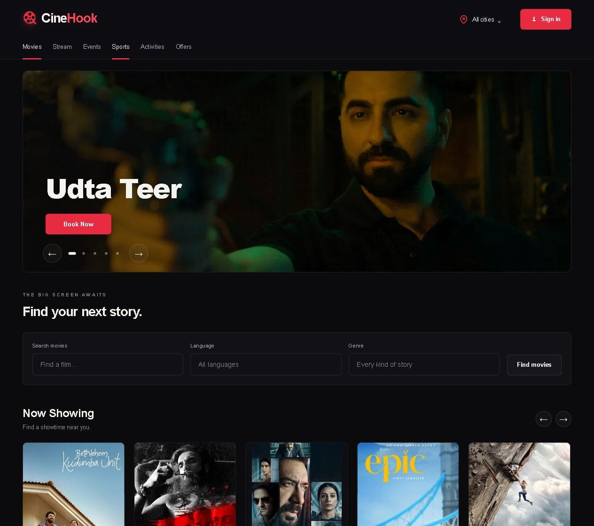
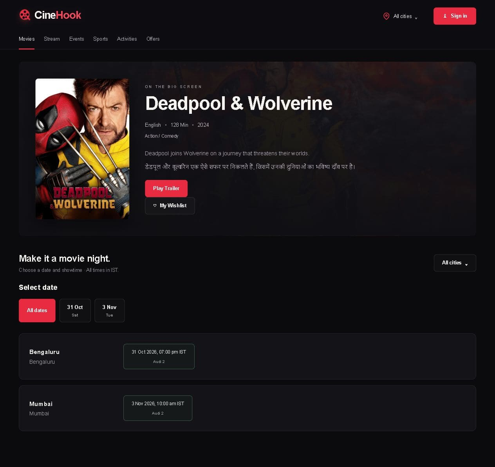
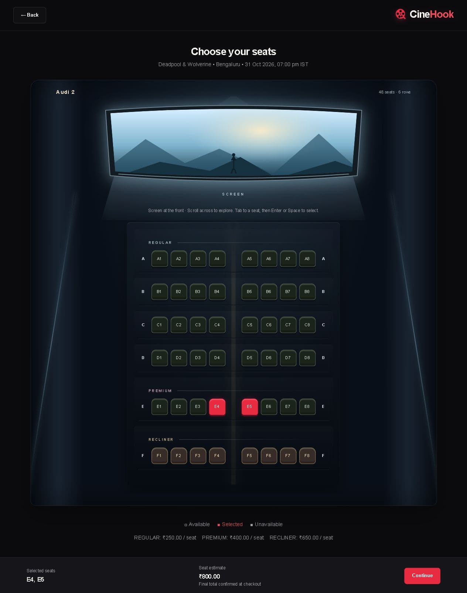
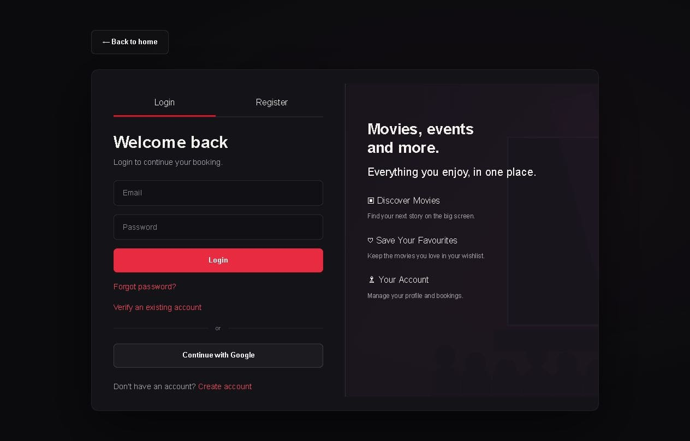
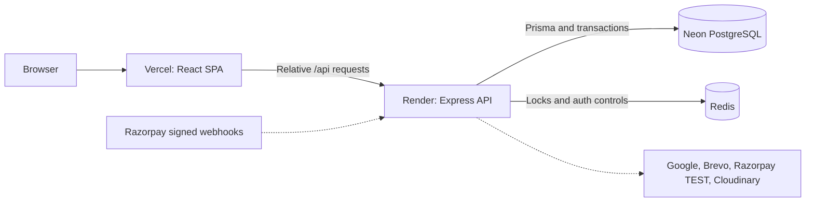

# CineHook

### Cinema on the surface. Concurrency and financial correctness underneath.

CineHook is a full-stack ticket-booking application with a cinematic React interface,
Redis seat reservations, PostgreSQL-backed booking guarantees, and verified Razorpay
**TEST** payments. It follows a booking beyond checkout—through browser closure,
duplicate webhooks, cancellation, refunds and recovery.

[**Open live app**](https://cine-hook-xi.vercel.app/) ·
[Architecture](docs/architecture.md) · [Local setup](docs/local-development.md) ·
[Testing & recovery](docs/testing-and-recovery.md)

[](https://github.com/GauravSh7/Cine-Hook/actions/workflows/ci.yml)



> Portfolio application: Razorpay TEST mode, not real ticket sales. Venue/session
> inventory is illustrative. TEST bills use explicit simulated tax policies and
> are not GST tax invoices. Render Free can take time to wake after inactivity.

## Explore the product

**Choose a city → discover a film → select a show and seats → receive a five-minute
hold → apply a coupon → review the server bill → complete TEST checkout → view a ticket.**

- Movie search, language/genre filtering, English/Hindi descriptions, and
  available TMDB ratings/trailers; state/city selection with optional geolocation.
- Numbered cinema seats, category-specific event/stadium layouts, show dates and
  backend availability. Supported Events, Sports and Activities share checkout;
  Stream has no fabricated streaming or bookable inventory.
- Password registration with email OTP, Google sign-in, password recovery,
  editable profiles, calculated age from DOB, Cloudinary avatars and persistent wishlists.
- My Bookings, ticket print/Save as PDF, unpaid checkout cancellation, and
  authoritative refund progress. Admin APIs/screens manage catalogue and inspect
  bookings, payments and reconciliation.
- FIRST50/SAVE10 and an itemised server-generated bill. No browser-supplied price,
  tax, refund amount or payment-success flag is authoritative.

<details>
<summary>More live screenshots</summary>

**Movie details and showtimes**



**Seat selection**



**Sign-in**



Captured from the deployed application on 24 October 2026. Seat highlights are
local selections, not reservations. No private account or financial records were
used. Checkout/My Bookings captures are deferred; see [capture notes](docs/assets/README.md).
</details>

## Stack

| Layer | Implementation |
| --- | --- |
| Web | React 19, TypeScript, Vite, Tailwind CSS, React Router |
| API | Node.js 24, Express 5, TypeScript, Zod, Helmet |
| Persistence | PostgreSQL on Neon, Prisma with PostgreSQL adapter |
| Coordination | Redis: atomic Lua seat locks, OTP proofs and auth abuse budgets |
| Identity/email | Google Identity Services + server ID-token verification; bcrypt; JWT; Brevo HTTPS transactional mail |
| Payments/media | Razorpay TEST checkout/webhooks/refunds; Cloudinary avatars; TMDB metadata/artwork references |
| Delivery | Vercel frontend/API rewrite, Render Docker backend, GitHub Actions |

## Architecture



The API is a **modular monolith**, not a collection of microservices:

`Route → Middleware → Controller → Service → Repository → Prisma → PostgreSQL`

Frontend API clients are separate from components. Booking, pricing, payment,
refund and provider responsibilities remain separate. Redis coordinates temporary
work; PostgreSQL owns durable identity, allocation and financial truth.
See [the detailed diagrams and source map](docs/architecture.md).

## Engineering decisions worth inspecting

### Identity must prove ownership

Registration requires a mailbox-bound, expiring OTP proof before a password
account is activated. Codes expire after ten minutes, have at most five attempts,
and are single-use; resending invalidates the old code.

Google login identifies an account by a verified **Google subject**, not email
string equality. Legacy recovery preserves history only with continuity proof;
a clean-account recovery quarantines the old identity and does **not** inherit
its private bookings. Auth-version checks invalidate old JWTs after credential/
ownership changes. Protected requests recheck current identity and role.

Passwords are bcrypt-hashed. JWTs validate algorithm, issuer, audience and expiry;
the frontend stores its access token in per-tab session storage, not an HttpOnly
session cookie. This carries browser-script/XSS exposure risk. Google challenge
cookies use nonce/CSRF checks. No refresh-token system is claimed.

### A selected seat is not yet a ticket

Lua acquires all requested seats atomically for five minutes, fenced by owner and
booking ID. Holds are not silently renewed. A short PostgreSQL transaction
revalidates inventory/prices and persists immutable seat-price snapshots.
Unique allocations and database guards protect confirmation even when requests race.

Only a trusted internal confirmation path can create a confirmed allocation.
Availability is advisory; actual acquisition/confirmation enforce correctness.
Cancellation atomically releases permanent allocations without deleting seat history.

### Financial outcome is separate from fulfilment

Order creation uses frozen server totals. Backend checkout verification and
raw-body webhook HMAC verification establish provider evidence. Provider order,
payment, event and refund identifiers make retries idempotent.

A captured payment remains financial success even when a hold expired or ticket
fulfilment fails; it creates a durable compensation/refund obligation, never revived
seats. Provider calls run outside database transactions. Refund outages leave
`Booking=CANCELLED` and `Payment=REFUND_PENDING`, not a restored booking.

Confirmed cancellation requires ownership, **less than 24 hours since creation**,
a future start, and **not the show/session date in Asia/Kolkata**. Eligible paid
cancellations receive the full captured amount; paid-but-unfulfilled compensation
is independent of that cancellation window.

### FIRST50 cannot be recycled after capture

One durable per-user reservation serializes competing discounted checkouts.
Verified capture permanently consumes FIRST50, including later cancellation/refund.
Definitively unpaid cancellation releases eligibility; uncertain provider outcomes
stay protected. An unrelated full-price checkout does not incorrectly require the
cancelled FIRST50 reservation. SQL constraints and tests enforce these boundaries.

## Testing, CI and operations

[Verified CI run at `76c42a74`](https://github.com/GauravSh7/Cine-Hook/actions/runs/39932938696):

| Evidence | Passing count |
| --- | ---: |
| Backend unit tests | **850** / 69 files |
| Frontend tests | **273** / 31 files |
| PostgreSQL/Redis integration checks | **114** |
| Compiled process smoke tests | **3** |

Frontend lint, both typechecks/builds, Prisma validation and all **17** migrations
passed in CI. The earlier **local** backend report recorded 862 tests; that is
not the reviewed CI job's 850 count. Counts overlap across historical runs and
are not added together.

Tests exercise simultaneous seat acquisition, owner fencing/TTL, ownership and
JWT races, FIRST50, signed/duplicate webhooks, capture after expiry, cancellation/
rebooking, provider outages and durable refund retries. Integration provider I/O
uses controlled transport—not real settlement. See [evidence and recovery](docs/testing-and-recovery.md).

- PR/push CI has backend, frontend and critical-integration jobs using disposable
  PostgreSQL/Redis. Failures block a green check; CI does not deploy production.
- Atomic Redis auth limits: login **10/15 min per email**, registration **5/hour**,
  plus an explicit deployment abuse budget. No guessed proxy IP or spoofed
  forwarding header separates users. Redis failure is handled fail-closed.
- Liveness `/api/health/live`; PostgreSQL/Redis readiness `/api/health/ready`.
  Structured lifecycle/error logs use server-owned request IDs and redact secrets.
- Opt-in hourly read-only uptime workflow accommodates cold starts.
  [Manual monitoring run passed](https://github.com/GauravSh7/Cine-Hook/actions/runs/40088443962).
  Frontend keyword monitoring/email notifications are operator-managed; **actual
  alert-email delivery verification remains deferred**.
- Releases are manual: Render Auto-Deploy OFF, Vercel automatic builds paused.
  This is CI plus a controlled release process, not unattended continuous deployment.

## Run locally

Requires Node.js **24.14+ within 24.x**, npm, local PostgreSQL **5432**, Redis and a
separate `cinehook_dev` database owned by your local application role. Do not reset
an existing database or start another PostgreSQL service over an occupied port.

```sh
git clone https://github.com/GauravSh7/Cine-Hook.git
cd Cine-Hook/backend
npm ci
```

On a **new installation only**, copy [backend/.env.example](backend/.env.example)
to `backend/.env`; configure private local database/Redis settings and generate a
strong `JWT_SECRET`. Keep `NODE_ENV=development`, `PORT=4000` and
`FRONTEND_ORIGIN=http://localhost:5173`. There is no required frontend env file:
Vite forwards relative `/api` requests to port 4000.

```sh
# backend/ — after cinehook_dev has been created privately
npm run db:generate
npm run dev:db:check
npm run dev:db:migrate
npm run db:seed:dev
npm run dev:populated
```

```sh
# second terminal: frontend/
npm ci
npm run dev -- --port 5173 --strictPort
```

Open [localhost:5173](http://localhost:5173). Brevo is needed for registration/
recovery OTPs; Google, Cloudinary and Razorpay each require their own configuration.
The guarded development seed is not a copy of hosted users or the full enriched
hosted catalogue. See [complete setup, provider gates and commands](docs/local-development.md).

## Deployment and boundaries

Render runs `npm start` from the built backend Docker image. Vercel serves the SPA
and rewrites `/api/*` to Render. Database migrations are **explicit**, not part of
startup: review target and pending migrations, verify a recovery checkpoint, then
run only the approved migration set during a coordinated window.

Hosted TEST checkout is explicitly gated by TEST credentials, webhook configuration
and the pinned staging database identity. Simulated GST, fee-waiver rules and
frozen quotes must never be reused as verified live-business tax configuration.

Known limits: Render cold starts; finite mail/abuse budgets; shared-budget denial
of service remains possible; no background refund worker; no guaranteed PITR/RPO/
RTO; no waiting room, WebSockets/SSE, horizontal-scale or load-test claim. Stream
and chatbot support remain placeholders. No real-money payment readiness is claimed.

## Documentation

- [Architecture and diagrams](docs/architecture.md)
- [Local development and deployment](docs/local-development.md)
- [Testing, backup and recovery](docs/testing-and-recovery.md)
- [Auth ownership design and rollout](docs/auth-ownership-rollout.md)
- [CI, rate limits and monitoring](docs/pointer2-operations.md)
- [Documentation index and historical notes](docs/README.md)

**Media:** This product uses the TMDB API but is not endorsed or certified by TMDB.
Movie artwork belongs to its respective rights holders; metadata and media usage
remain subject to provider terms. See [media review](docs/staging-media-review.md).
Repository source availability does not grant ownership of third-party artwork.
