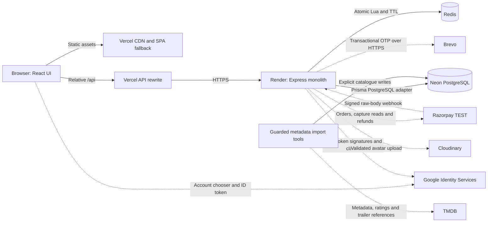
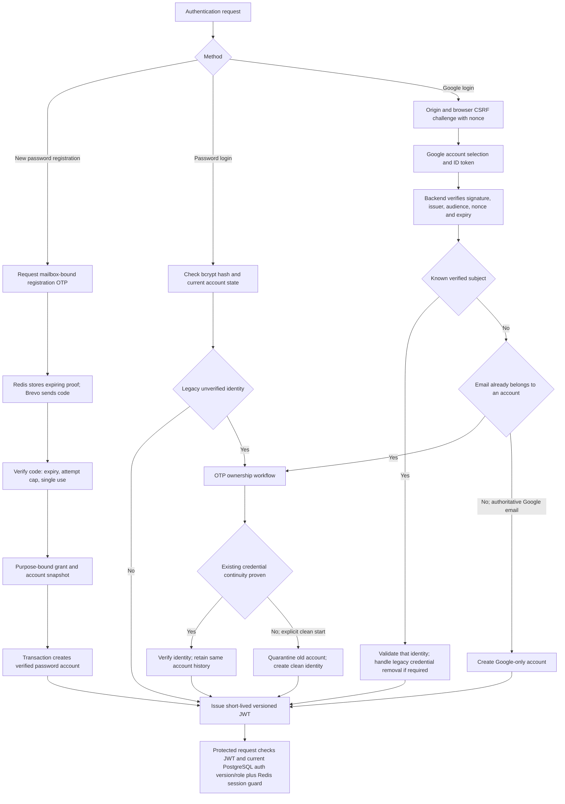
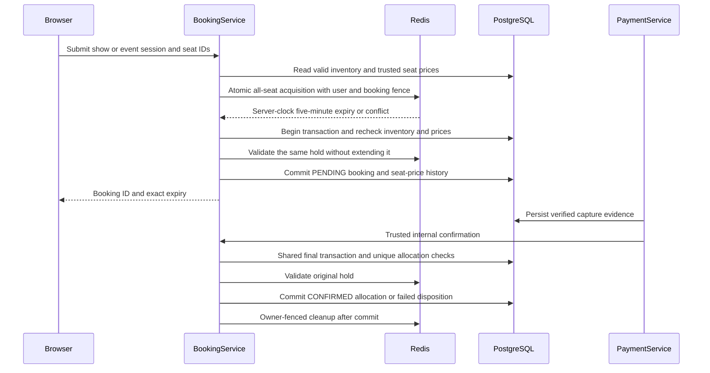
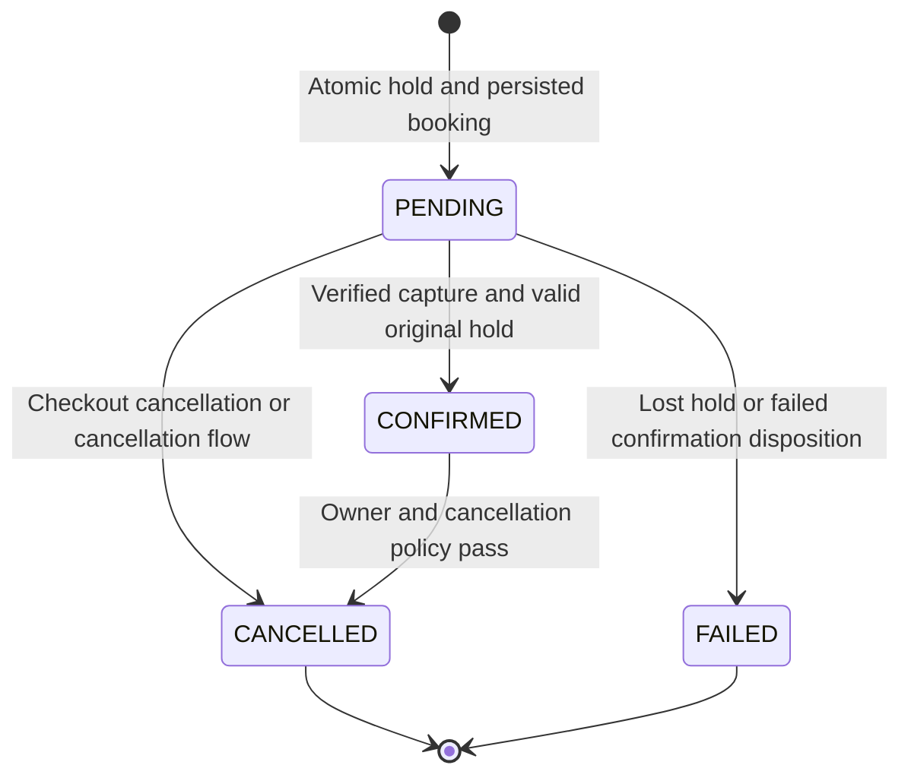
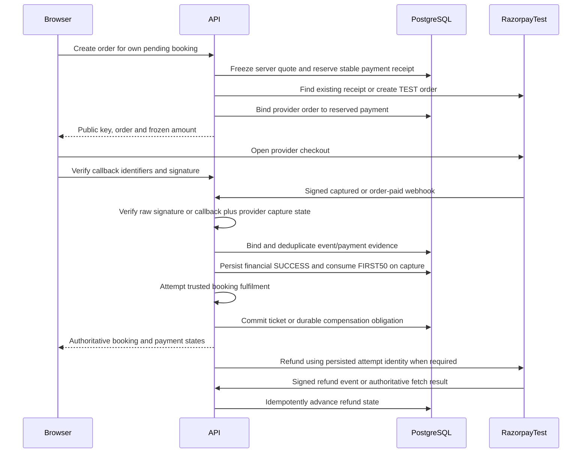
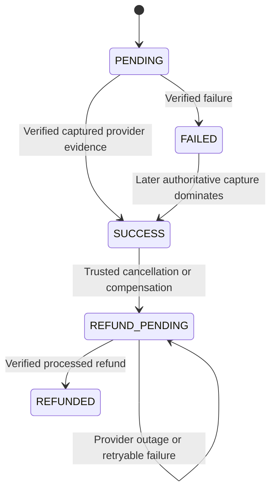
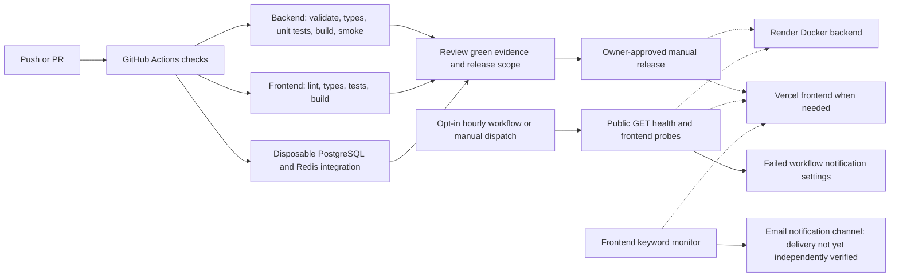

# CineHook architecture

Implementation baseline: `76c42a74` (24 October 2026 documentation pass).
CineHook is a modular Express monolith with a separately deployed React SPA.
These diagrams describe implemented paths, not a hypothetical scaling roadmap.

## 1. System and trust boundaries

- The frontend calls relative API URLs; `frontend/vercel.json` routes those to
  Render. The direct Render URL remains public: Vercel is **not** an authentication
  boundary or a trusted client-IP attestation service.
- Runtime composition is in `backend/src/server.ts`. HTTP layering is in
  `backend/src/app.ts`: maintenance guard, request IDs/telemetry, Helmet/CORS,
  raw webhooks, JSON parsing, auth limits and domain routes.
- Domain flow: **Route → Middleware → Controller → Service → Repository →
  Prisma → PostgreSQL**. Redis services and provider adapters are separate
  collaborators, not hidden database or HTTP work inside UI components.
- PostgreSQL owns accounts, catalogue, booking history, prices, allocations,
  coupon consumption and financial evidence. Redis owns expiring holds/proofs
  and abuse counters. There is no cross-store distributed transaction.
- TMDB enrichment is an explicit tool operation, not a fresh TMDB API call for
  every card. Images/trailers use stored provider references and attribution.

## 2. Authentication and ownership

Sources: `modules/auth/ownership.service.ts`, `ownership.repository.ts`,
`ownership-proof.store.ts`, `google/google.service.ts`, `token.service.ts` and
`frontend/src/app/SessionProvider.tsx`.

- Email equality never silently links a Google identity. Explicit linking to a
  verified password account requires an authenticated session, password proof,
  matching verified Google evidence and a serialized identity recheck.
- Mailbox ownership alone never exposes an unverified account's private history.
  Quarantine disables the old identity/credentials and changes its claimable
  email while keeping bookings, payments, refunds and audit relationships intact.
  The new identity has no inherited access. Continuity proof preserves the
  legitimate account's existing history. Google-only users need no password.
- Registration/reset/legacy/clean-start proofs bind purpose, email and the account
  snapshot; expiry, replay, resend and concurrent updates fail safely. Reset
  rejects password reuse and increments durable auth version.
- JWTs are HS256 with issuer/audience/expiry validation and a maximum configured
  lifetime of 24 hours. Tokens live in per-tab `sessionStorage`; logout clears
  the browser token. This is not an HttpOnly-cookie/refresh-token design.
- Auth limits use HMAC-derived identity keys, not spoofable forwarding headers.
  The approved hosted fallback uses mailbox budgets, with deliberate shared
  deployment limits rather than a guessed Render/Vercel client-IP quota.

## 3. Reservation and durable confirmation

Sources: `modules/booking/`, `modules/event-booking/`, `modules/seat-lock/`,
`modules/pricing/` and Prisma SQL migrations. `BookingGateway` routes the enforced
movie-or-event target to its domain service; payment/refund orchestration is shared.

- Expiry/failure paths retain their reason codes; legacy hold-release paths can
  produce FAILED, while the checkout coordinator cancels definitively unpaid
  checkout. Neither terminal state is revived by a late payment.
- Lua acquisition is all-or-nothing. Fenced release prevents an old request from
  deleting another hold, including a later hold by the same user. No implicit TTL
  renewal occurs. An availability read is advisory, never a reservation.
- PostgreSQL unique allocations protect `(show, seat)` or `(session, seat)` even
  under races. READ COMMITTED transaction guards and database locks enforce state
  transitions. Showtime exclusion constraints prevent overlapping scheduled shows.
- Redis acquisition and SQL persistence are not atomic together. Lost
  acknowledgements/failures use fenced compensation, retained evidence and safe
  retry. Confirmed allocations do not disappear when Redis loses temporary data.
- Confirmed cancellation requires age less than 24 hours, a future start and not
  the current IST show/session date. Cancellation releases allocations and records
  refund intent atomically; historical seat rows/prices are not deleted.

## 4. Razorpay TEST evidence, idempotency and compensation

The callback and webhook paths may arrive in either order; the diagram shows both
entry points, not a requirement that both arrive. Authorization alone is not
capture. Browser closure does not prevent signed webhook recovery.

Sources: `modules/payments/payment.service.ts`, `payment.repository.ts`,
`razorpay.provider.ts`, `modules/refunds/` and `modules/pricing/`.

- Webhook raw bytes are read before JSON parsing; HMAC uses a separate secret.
  Provider identities, receipt, amount, currency and source binding are checked.
- Capture evidence commits before fulfilment. Provider HTTP runs outside database
  transactions. A late captured payment cannot extend a hold or reacquire seats;
  paid-but-unfulfilled compensation is full-source regardless of show time.
- Refund intent/attempt IDs survive provider outages and lost acknowledgements.
  Replays cannot create duplicate allocations or duplicate refund obligations.
  Cancellation stays durable while refund state is pending.
- FIRST50 uses a per-user durable reservation and serialized eligibility checks.
  Capture permanently consumes it, including later refund. Unknown external
  outcomes are not treated as definitively unpaid; full-price orders remain
  independent of another uncertain discounted reservation.
- Integer-paise quotes snapshot discounts, included admission tax and waived fee
  policy. TEST simulation is provenance-labelled and gated by environment,
  TEST credentials and the approved database identity. It is not legal tax
  classification, a GST invoice, or permission to accept real money.

## 5. CI, controlled delivery and monitoring

Sources: `.github/workflows/ci.yml`, `.github/workflows/uptime.yml`,
`backend/scripts/uptime-probe.mjs`, `lib/lifecycle.ts`,
`middleware/request-telemetry.ts` and [operations](pointer2-operations.md).

CI has no production-deploy job. Automatic Render/Vercel releases remain gated;
database migrations require target/checkpoint review, not an automatic startup
side effect. GitHub uptime activation uses `UPTIME_MONITORING_ENABLED=true`.
Hourly probes allow a 75-second request timeout and one retry, rather than a
five-minute backend keep-awake loop. Render liveness is distinct from dependency
readiness. Structured logs omit bodies, raw query strings, tokens and provider
payloads. Request IDs correlate failures without sharing credentials.

Monitoring configuration and a successful probe do not prove an alert reached an
inbox. No uptime SLA, production load benchmark, distributed scaling guarantee,
background refund queue or automatic financial recovery is claimed. For operational
steps and Redis/database-loss limits, use [testing and recovery](testing-and-recovery.md).
